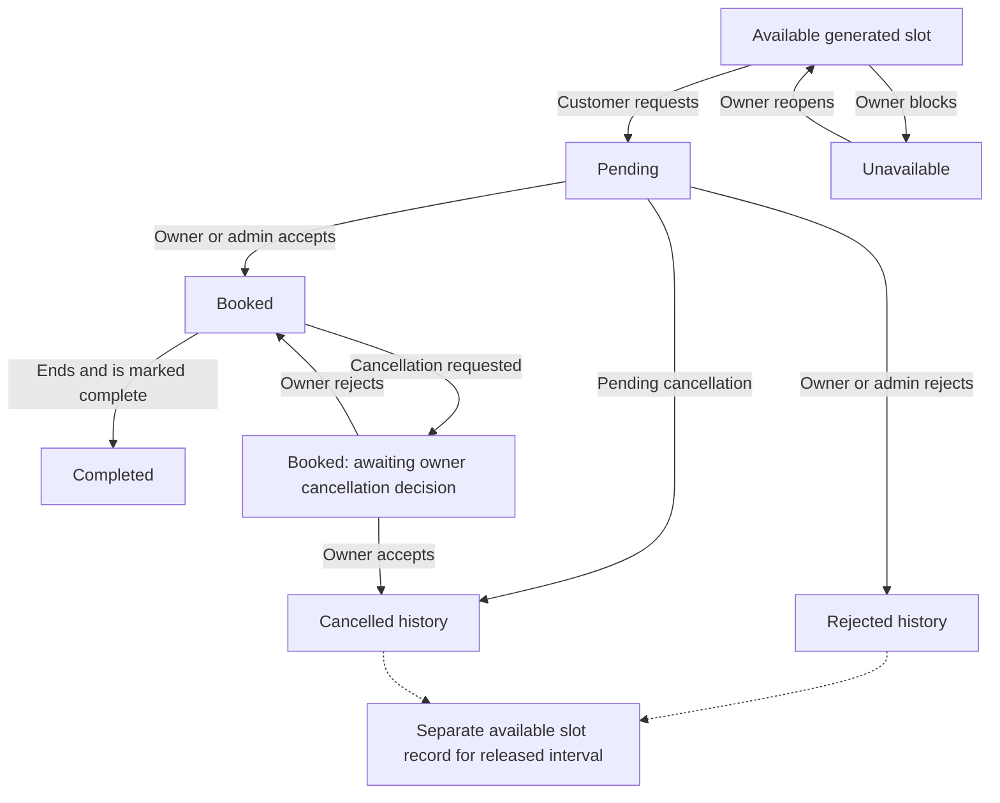
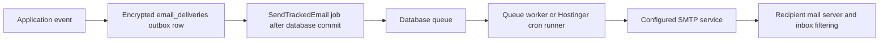

# SportEvo — Complete Product Context, PRD and Technical Handover

**Prepared:** 19 October 2026 · **Updated:** 27 October 2026 · **Project:** SportEvo · **Public domain:** https://sportevo.games

This is a standalone context file for discussing SportEvo with ChatGPT, a developer, a designer or a project collaborator. It describes the existing application, the owner's decisions, implementation rules, operating procedures and remaining uncertainties. It combines a product brief, current-state PRD and technical handover.

It was prepared from the local repository at `E:\sportevo`, project documentation, source code and historical deployment logs. It is **not a new live-site audit**. Source code establishes what is implemented locally; deployment logs establish historical activation; neither alone proves the current state of every production feature.

No passwords, application encryption keys, database credentials, Gmail app passwords, session cookies or private customer records are included. Environment-variable names below are identifiers, not their secret values.

**Published feature update, 19 October 2026:** manual advance payments are live on Hostinger. Read Section 32 and `ADVANCE-PAYMENTS.md` for the workflow, which supersedes older acceptance-only accounting descriptions below. Activation, schema/routes, asset content types and real public home/login rendering were verified. It adds customer phones, owner payment accounts, deadlines/review and occupied-slot visibility; it does not add a payment-provider API or automatic money transfers.

## Contents

**Latest published follow-up, 26 October:** navbar complex search is live and verified. Desktop has a search icon and phones have a search form inside the hamburger menu. Directory queries/filters persist in the URL. See Section 37.

**Latest published follow-up, 26 October:** direct peak-only generation and deletion of selected unused available slots (including past unused slots) are live and verified. Booked/offline/request/history records are protected. See Section 36 and `SLOT-GENERATION-CLEANUP.md`.

**Latest published follow-up, 26 October:** optional players per side, Football/Futsal consolidation and sending verified signed-in owners from `/` directly to the main field schedule are live. See Section 35 and `FIELD-PLAYERS.md`.

**Published follow-up, 26 October:** explicit **Already booked (offline)** owner slot classification is live. See Section 33 and `FIELD-SCHEDULE.md`.

**Published update, 26 October:** peak/custom slot prices, overnight generation and simpler owner pages are live and verified. Owner login now leads to the main field schedule; management forms are grouped in expandable sections. See Section 34 and `SLOT-PRICING.md`.

1. [How to give this file to ChatGPT](#1-how-to-give-this-file-to-chatgpt)
2. [Product identity and owner decisions](#2-product-identity-and-owner-decisions)
3. [Product purpose, scope and terminology](#3-product-purpose-scope-and-terminology)
4. [People, roles and permissions](#4-people-roles-and-permissions)
5. [Customer journey](#5-customer-journey)
6. [Owner journey and complex registration](#6-owner-journey-and-complex-registration)
7. [Fields, sports and photographs](#7-fields-sports-and-photographs)
8. [Schedules and slot generation](#8-schedules-and-slot-generation)
9. [Booking lifecycle and concurrency rules](#9-booking-lifecycle-and-concurrency-rules)
10. [Pricing, commission and wallets](#10-pricing-commission-and-wallets)
11. [Cancellation and commission reversal](#11-cancellation-and-commission-reversal)
12. [Reviews, deletion and historical records](#12-reviews-deletion-and-historical-records)
13. [Contact messages and issue reports](#13-contact-messages-and-issue-reports)
14. [Email delivery and notifications](#14-email-delivery-and-notifications)
15. [Authentication and idle logout](#15-authentication-and-idle-logout)
16. [Interface, branding, animation and accessibility](#16-interface-branding-animation-and-accessibility)
17. [English and Bangla](#17-english-and-bangla)
18. [Frontend page map](#18-frontend-page-map)
19. [Technical architecture and source map](#19-technical-architecture-and-source-map)
20. [Database and data relationships](#20-database-and-data-relationships)
21. [API reference](#21-api-reference)
22. [Validation and rate limits](#22-validation-and-rate-limits)
23. [Privacy, encryption and security](#23-privacy-encryption-and-security)
24. [Local development and verification](#24-local-development-and-verification)
25. [Production hosting and deployment](#25-production-hosting-and-deployment)
26. [Backups, recovery and incident knowledge](#26-backups-recovery-and-incident-knowledge)
27. [Testing evidence and release confidence](#27-testing-evidence-and-release-confidence)
28. [Current limitations and possible future work](#28-current-limitations-and-possible-future-work)
29. [Acceptance criteria and practical examples](#29-acceptance-criteria-and-practical-examples)
30. [Working rules for future assistants](#30-working-rules-for-future-assistants)
31. [Project glossary and supporting files](#31-project-glossary-and-supporting-files)
32. [Manual advance payments update](#32-manual-advance-payments-update)
33. [Offline booking classification](#33-offline-booking-classification)
34. [Peak pricing and simpler owner schedules](#34-peak-pricing-and-simpler-owner-schedules)
35. [Field team sizes, Football and returning owners](#35-field-team-sizes-football-and-returning-owners)
36. [Peak-only generation and deleting unused slots](#36-peak-only-generation-and-deleting-unused-slots)
37. [Navbar complex search](#37-navbar-complex-search)

## 1. How to give this file to ChatGPT

Upload this Markdown file to the conversation, then use the following prompt. The file is understandable without access to the original development conversation. If a question requires inspecting a particular implementation, also provide the relevant source files; this document is a description, not a copy of the entire application.

```text
This attached document describes my existing project, SportEvo. Read it before
answering. Treat it as project context, with a snapshot date of 19 October 2026.

Help me discuss and improve this actual product. Separate:
1. Implemented behavior described in the document.
2. My established preferences and requirements.
3. Your proposed improvements.
4. Anything that needs current source-code or production verification.

Do not invent implemented features, live statistics, integrations, payments,
partnerships, guarantees or security certifications. Do not ask me to share
passwords or encryption keys. Preserve existing bookings, history and privacy.

The brand is SportEvo, the domain is sportevo.games, the market is all of
Bangladesh, prices are in BDT/taka, and the interface supports English/Bangla.

Use clear, practical language. Explain tradeoffs and maintain the documented
business rules unless I explicitly change them. If we discuss a new feature,
identify the effects on customers, owners, admins, data, permissions, emails,
mobile layouts and existing bookings.

What I want to discuss now: [WRITE YOUR QUESTION OR IDEA HERE]
```

Examples of follow-up questions:

- “Act as a product manager and prioritize the next five improvements.”
- “Explain the booking and commission system to a nontechnical business partner.”
- “Write a developer ticket for this feature, including acceptance criteria.”
- “Review the cancellation process and identify confusing steps.”
- “Design an improved mobile owner schedule without changing booking rules.”
- “Help me write a client presentation using only implemented capabilities.”
- “Turn the roadmap into a phased PRD and mark all assumptions.”
- “Explain what must change before adding online customer payments.”

## 2. Product identity and owner decisions

| Item | Established direction |
| --- | --- |
| Brand spelling | **SportEvo**; capital S and E. Older filenames/docs may say Sportevo or Sports Evo. |
| Domain | **sportevo.games**. Similar misspellings are not evidence of an owned domain or configured redirect. |
| Market | Sports participants and sports-complex owners across **Bangladesh**. |
| Geographic positioning | National platform. Do not brand the whole service as belonging to one city. Actual complex locations remain useful listing information. |
| Currency | Bangladeshi taka: **BDT / ৳**. Dollar symbols and USD wording were replaced. This is currency presentation, not foreign-exchange conversion. |
| Languages | English and Bangla, with a user-selectable interface language. |
| Brand colors | Evergreen/dark green foundations, bright mint and coral accents. The owner asked to keep green and replace the earlier yellow. |
| Typefaces | Manrope and Space Grotesk, with Noto Sans Bengali for Bangla glyphs. |
| Logo | Owner-selected artistic green/coral sports monogram, supplied as a transparent asset. Keep this identity unless asked to redesign it. |
| Root page | Visiting `/` must show the public landing page, including for guests and expired sessions. |
| Mobile navigation | Hamburger menu for navigation links on narrower screens. |
| Mobile visual experience | Keep the same designed hero/3D identity on phones; do not substitute an unrelated, poor-quality mobile image. |
| Initial admin provisioning | Keep the manually invoked platform-admin seeding approach. Public signup must not grant administrative roles. |
| Data safety | Preserve accounts, encryption keys, original booking quotes, commission and historical records during updates. |
| Publishing | The project is hosted on Hostinger. Local changes and online changes are distinct; an upload is not proof of successful activation. |

The owner initially used another sports website as a visual reference, then requested distinct typography, colors and artwork. SportEvo is its own national multi-complex platform, not a claim to operate that reference site's venue.

## 3. Product purpose, scope and terminology

SportEvo lets people discover approved sports complexes, select a specific field/facility, view photographs and prices, choose a generated time slot and submit a booking request. Owners accept or reject requests and manage their own fields and schedules. Platform administrators approve complexes, oversee bookings and accounts, manage commission records and handle support.

The business model records commission owed by an owner. Without a required advance, commission starts at acceptance. With a required advance, it starts only after receipt confirmation or explicit waiver. The application does not collect the customer's money through a payment gateway.

### Product goals

- Make multiple sports and complexes discoverable from one site.
- Give each field independent availability, photos and pricing.
- Avoid both same-field double booking and a customer's simultaneous overlapping requests.
- Make requests, approvals and cancellations traceable.
- Keep owner commission accounting separate from customer payment handling.
- Provide usable customer, owner and admin interfaces on phones and desktops.
- Support Bangladesh-wide positioning, taka and Bangla.

These are product goals, not measured adoption or revenue results. No active-user count, commercial conversion rate, revenue figure, nationwide venue count or service-level guarantee is established here.

### Key distinctions

| Term | Meaning in this application |
| --- | --- |
| Complex / turf | The owner-managed venue record. Backend names often use `Turf`, `turfs` and `turf_id`. |
| Field / facility | An individually bookable space inside a complex. It can represent a pitch, court or other sporting facility. |
| Slot | A generated start/end interval on a specific field. |
| Request | A customer has selected an available slot, but acceptance is still pending. |
| Accepted booking | Backend status `booked`; inspect advance state to distinguish awaiting payment/review from confirmed. Commission waits for required receipt confirmation/waiver. |
| Wallet | A ledger of the owner's platform commission debt/credit. It is not stored customer spending money. |
| Settlement | An admin-recorded payment against owner commission debt; the application does not itself transfer money. |
| Commission reversal | A credit against owner commission after the required cancellation approvals. |
| Delete / archive | Generally soft deletion retaining history, not erasure of all records. |

## 4. People, roles and permissions

Four account roles exist. A guest is an unauthenticated visitor, not a database role.

| Capability | Guest | Customer `user` | Owner `turf` | Admin | Superadmin |
| --- | --- | --- | --- | --- | --- |
| Browse public approved complexes/fields | Yes | Yes | Yes | Yes | Yes |
| Use the public contact form | Yes | Yes | Yes | Yes | Yes |
| Request a field slot as a customer | No | Yes | No | No | No |
| View own customer bookings / request cancellation | No | Yes | No | Oversight tools | Oversight tools |
| Review a qualifying own booking | No | Yes | No | No | No |
| Register/manage an owned complex | No | No | One complex | Uses admin tools | Uses admin tools |
| Generate slots and block/reopen own open slots | No | No | Yes | No dedicated owner-route access | No dedicated owner-route access |
| Accept/reject booking requests | No | No | Own complex | Platform-wide | Platform-wide |
| Complete eligible finished bookings | No | No | Own complex | Platform-wide | Platform-wide |
| Decide accepted-booking cancellation as owner | No | No | Own complex | Separate commission decision | Separate commission decision |
| Submit dashboard issue reports | No | Yes | Yes | Admin inbox | Admin inbox |
| Read platform support inboxes | No | Own reports only | Own reports only | Yes | Yes |
| Approve complexes / set commission / record settlements | No | No | No | Yes | Yes |
| Archive fields or complexes | No | No | Request complex deletion | Yes, with blockers | Yes, with blockers |
| Remove another admin account | No | No | No | No | Yes |
| Create/manage superadmin access | No | No | No | No | Restricted to superadmin |

Public registration accepts only `user` and `turf`. API authorization is required even if a button is hidden in the frontend. Admins use `/dashboard/platform`, not the owner dashboard.

Additional permission rules in the current implementation:

- Admin-created accounts are marked email-verified. These are separate from public signup.
- An ordinary admin can create an admin; creating a superadmin requires a superadmin.
- Changing an existing admin's role requires a superadmin. Superadmin role management is restricted to superadmins.
- An active complex owner cannot be changed to a non-owner role while their active complex remains attached.
- An admin cannot use the other-user deletion endpoint to delete their own account; account settings is the self-deletion route.
- Other superadmin accounts cannot be deleted through the admin deletion endpoint.
- Do not interpret “admin” as unrestricted access to every owner-only API route. Check both route middleware and controller policies.

## 5. Customer journey

1. Open `sportevo.games`; see the landing page rather than a forced login screen.
2. Browse the homepage complexes section or the full directory.
3. Search by complex name/location and filter sports. “Other sport” permits a typed game name.
4. Open a complex to choose a field. Fields have independent names, sporting facilities, photos and rates.
5. Open the selected field's page, inspect its gallery, select a date and choose an available future slot.
6. Sign in or create a customer account when authentication is required.
7. For new public accounts, enter the emailed verification code before normal login is allowed.
8. Submit the booking request. The server validates the exact generated slot and calculates the quote.
9. See it as pending in the customer booking interface. A pending request is not a confirmed reservation accepted by the owner.
10. Receive an accepted/rejected update. If an advance is required, acceptance starts its deadline: pay the owner's displayed receiving account and submit a transaction ID/reference in My Bookings.
11. A timely reference keeps the slot held for owner review. Receipt confirmation (or waiver) confirms an advance-required reservation; unsubmitted expired holds are cancelled automatically. Money transfers occur externally, not through an integrated gateway.
12. Cancel through the documented workflow if necessary.
13. After a qualifying accepted/completed booking has ended, leave or update a review of the complex.

The customer bookings response separates pending requests, upcoming accepted bookings and past/history records. Customers cannot reserve arbitrary times that have not been generated as available slots.

## 6. Owner journey and complex registration

1. Register an owner account using role `turf`; verify its email.
2. Open the owner dashboard and register a complex.
3. Contact email and phone default to the logged-in profile. Owners can edit these defaults, including clearing a field before re-entering it.
4. Complex-specific name, location, sport choices and price are not copied from the person's profile. The first field retains the default name “Main field” unless changed.
5. Choose fixed-slot or hourly pricing, sports and optional first-field photos.
6. The complex is submitted for admin approval. It remains absent from the public directory until approved.
7. Prepare fields, photos and schedules through the owner tools.
8. Use the separate **Field schedule & slot generation** page for time-slot work.
9. Accept/reject requests, manage cancellation decisions, inspect wallet activity and adjust booking-request email preferences.

One owner account can register **one complex**, enforced against archived records as well. Archiving that complex does not free the same original owner ID to create a replacement. A different complex requires a separate account. A fresh account registered after an old account's deletion receives a different ID and does not inherit the old owner's facilities.

Every new complex starts with a first field. Owners may add additional fields/facilities within that same complex. A complex's contact email is contact information; the one-complex ownership rule is fundamentally tied to the owner account/manager identifier, not a license to infer new email-uniqueness rules for contact addresses.

## 7. Fields, sports and photographs

### Field information

A field has a complex association, name, sports, pricing mode, relevant rate and photographs. Owners can edit their own fields. Existing booking quotes are retained when those details or prices change.

### Sports catalogue

Seeded sports: Football, Cricket, Badminton, Basketball, Tennis, Futsal, Volleyball, Swimming, Boxing and Table Tennis.

The **Other sport** option exists when creating/editing fields and in customer sport searches:

- Owners enter a custom name, 2–80 characters, subject to the supported name-character rules.
- Catalogue entries are normalized/reused by slug rather than deliberately duplicated for every field.
- Non-Latin names can receive a stable hashed slug if ordinary slug generation is empty.
- A field can select up to 20 sports, including its custom addition.
- Search accepts a partial typed custom-sport name.
- A sport appearing in the catalogue does not prove an approved venue currently offers it; actual results depend on active fields.

### Field photographs

- JPG/JPEG, PNG and WebP are supported. HEIC is not accepted by the current picker; convert it first.
- Up to 8 files per upload and 5 MB per individual image.
- The frontend also limits the selected batch to 32 MB. Do not describe that frontend check as an independent aggregate backend validation rule; hosting/PHP body limits apply separately.
- Up to 24 stored photos per field, enforced on the backend under locks.
- Images are stored on the public filesystem and exposed through public storage URLs.
- Photo saving coordinates database operations and file writes; failed writes attempt to remove newly written files and roll back partial changes.
- The gallery has a cover, thumbnails and an accessible modal with next/previous controls and keyboard support.
- The owner controls use consistent minimum 44px tap targets, a 12px gap and wrapping/stacking in narrow spaces.
- A single stored photo uses “View photo”; multiple photos show a count. Upload remains disabled until files are selected.
- Archiving a field/complex preserves its historical photo records and files; explicit photo deletion is a different operation.

When an image cannot load or a complex has no cover, the card has a branded initials/gradient fallback rather than a broken image icon.

## 8. Schedules and slot generation

The dedicated owner page is `/dashboard/turf/schedule`, reached by a separate dashboard button. This moves schedule generation away from the already busy main owner dashboard.

### Schedule interface

- Dropdown selection of the field being managed.
- Calendar date input and previous/next date controls.
- Cards showing start/end time, duration, total quoted price and status.
- A selected-card area with applicable actions.
- Block/reopen actions for eligible open future slots.
- Accept/reject actions for pending requests.
- Completion for accepted bookings whose end time has passed, subject to cancellation rules.
- Slot generator and pricing editor opened on demand.
- Automatic refresh approximately every 30 seconds while the page is visible.
- Requests are keyed/cancelled so switching field/date does not intentionally display a stale response as the new selection.
- Phone layouts use a compact grid; selecting a card can scroll its details into view.

### Generation rules

An owner selects field, date, start time, end time and duration. Duration must be an integer from 15 to 240 minutes. Start must be in the future. The end time must be after the start on the selected date.

Generation produces only complete slots fitting within the range. A leftover partial interval is not generated. For example, a three-hour range with 90-minute duration produces two slots. A range shorter than one complete slot is rejected.

If **any** proposed interval overlaps an existing active interval on that field, the operation is rejected atomically: no partial batch is created. Generation considers `available`, `unavailable`, `pending`, `booked` and `completed` records as occupied for this purpose. Different fields have independent schedules.

The present generator is a same-date start/end form, not a recurring timetable editor or arbitrary overnight-range generator. Although overlap comparisons can handle timestamps across midnight, do not claim the generation form supports an end earlier than its start.

Use `APP_TIMEZONE=Asia/Dhaka` for Bangladesh generation. Browser displays use locale-aware date/time formatting; do not assume switching interface language also changes timezone. Changing the configured timezone of a populated database requires a data-conversion plan.

### Offline bookings and maintenance

Owners can mark a future `available` slot `unavailable` with a reason, such as a telephone booking or maintenance. It remains visible to customers as unavailable and cannot be booked online. Reopening is allowed for an eligible owner-blocked slot. The local follow-up in Section 33 adds a distinct offline-booked label.

Blocking does not create an online customer booking or commission charge. The slot must have no attached online customer/commission. Owners cannot overwrite pending or accepted online bookings with this shortcut. Conflicting intervals and past starts prevent the change.

## 9. Booking lifecycle and concurrency rules

### Status definitions

| Backend value | Meaning |
| --- | --- |
| `available` | Generated open interval, without a customer request. |
| `unavailable` | Owner-blocked interval, not available for online requests. |
| `pending` | Customer request awaiting a decision. |
| `booked` | Owner-accepted reservation; `advance_status` distinguishes awaiting payment/review from confirmed. Required-advance commission waits for receipt confirmation/waiver. |
| `rejected` | Request rejected; historical record retained. |
| `cancelled` | Cancelled request/booking; historical record retained. |
| `completed` | Accepted booking explicitly marked complete after its end. |



Rejection/cancellation does not erase the original customer record or rewrite it into an anonymous available slot. Release uses a separate available record for that field and interval. Public availability still excludes past times and conflicting occupied records.

### Two independent overlap protections

**Field protection:** simultaneous reservations cannot occupy the same field at overlapping times. Another field, even at the same complex, can be booked during that time.

**Customer protection:** the same customer cannot have another overlapping `pending` request or `booked` booking anywhere across complexes and fields. A pending request must be rejected/cancelled before another overlapping request can be made. Asking to cancel a booked reservation does not release the customer's time until the cancellation is accepted.

The overlap condition is:

```text
existing.start < requested.end AND existing.end > requested.start
```

Therefore 10:00–11:00 and 11:00–12:00 are adjacent and allowed. 10:00–11:00 and 10:30–11:30 overlap. Partial overlaps and intervals spanning midnight are covered by the comparisons.

### Submission and decisions

- The complex must be approved and the field active.
- The customer must select an exact generated, available interval on that field.
- Past-start requests are rejected.
- The server computes price and commission-rate snapshot; client-supplied prices are not trusted.
- Customer row locking serializes concurrent requests from that customer across venues. Complex/field/booking locks protect schedule updates and decisions.
- A conflicting new request returns HTTP 409 and does not consume the target slot.
- Acceptance applies only to pending future-start requests and rechecks availability/approval.
- Acceptance charges commission once when no advance is required. Required-advance acceptance starts a hold; receipt confirmation/waiver charges original commission once instead.
- Completion requires status `booked`, an ended interval and no unresolved pending cancellation.
- Completion is an explicit owner/admin action; elapsed time alone is not proof that the record has transitioned to `completed`.

### Customer privacy before acceptance

Owner-facing pending records hide the customer relation and user identifier until commission/acceptance has been established. Booking-request notification emails also omit customer contact details. This does not prohibit administrators from seeing customer information in their authorized oversight tools.

## 10. Pricing, commission and wallets

### Field pricing modes

| Mode | Data | Calculation |
| --- | --- | --- |
| Fixed slot | `pricing_mode=slot`, `price_per_slot` | Same configured rate for the chosen generated slot, regardless of its duration. |
| Hourly | `pricing_mode=hour`, `price_per_hour` | Hourly rate prorated by actual slot duration, rounded to two decimal places. |

Allowed configured rates are 0–100,000. Existing fields default to fixed-slot mode. Available/blocked slot cards derive their current price from the field; submitted requests retain a price snapshot.

Examples:

| Field setup | Slot duration | Total quote |
| --- | --- | --- |
| ৳1,000/hour | 60 minutes | ৳1,000 |
| ৳1,000/hour | 90 minutes | ৳1,500 |
| ৳800/hour | 45 minutes | ৳600 |
| ৳1,200/slot | 60 minutes | ৳1,200 |
| ৳1,200/slot | 90 minutes | ৳1,200 |

The quote function calculates hourly amounts using rate cents and actual seconds. The same calculation is used for public slot display, owner schedule display and request creation. Mixed-basis complex summaries say “Prices vary by field” instead of comparing an hourly rate directly with a per-slot total.

### Quote preservation

Changing a field's rate or a complex's commission does not alter an existing request/booking quote. New requests use current settings. Acceptance uses the request's stored price and commission rate.

### Commission

- Default complex commission is 10%; admins can configure 0–100%.
- `commission_amount = round(quoted_price × quoted_commission_rate / 100, 2)`.
- A pending request incurs no charge.
- Acceptance creates a `commission_charge` when no advance is required. Required-advance bookings are charged after receipt confirmation or waiver instead. Unpaid expiry leaves no commission debt.
- Commission is not described as an extra customer checkout fee; this implementation tracks the owner's debt to the platform.

### Wallet formula

```text
Owner wallet balance
  = commission charges
  - recorded settlements
  - approved commission reversals
```

A positive balance is owed to SportEvo. Zero is settled. A negative balance is owner credit, which can occur if a previously settled commission is later reversed.

An admin records a positive settlement with an optional note; it must not exceed the outstanding balance. Recording it is accounting, not an automatic bank/mobile-wallet transfer. Archived complex wallet/history access remains available to admins.

## 11. Cancellation and commission reversal

### Pending request

For a future pending request, cancellation is immediate. The original becomes `cancelled`, the time is released and there is no acceptance commission to refund.

### Accepted booking

An accepted unpaid advance hold with no submitted reference can be cancelled immediately without commission. A submitted reference follows owner cancellation review so a claimed transfer is not silently discarded. If no commission was charged, accepted cancellation needs no platform commission credit. Actual customer-money refunds are arranged directly with the owner.

1. A cancellation is requested against the future accepted booking, optionally with a reason.
2. The booking stays `booked`, occupies the field and keeps its commission charge while the owner decision is pending.
3. The owner accepts or rejects the cancellation.
4. Owner rejection keeps the booking confirmed and makes commission reversal ineligible.
5. Owner acceptance changes the booking to `cancelled` and releases the interval. Commission remains owed until the admin decision.
6. An admin/superadmin accepts or rejects the commission reversal.
7. Approval inserts one `commission_refunds` credit and reduces the owner's wallet debt. Rejection leaves the charge owed.

Cancellation rows track owner and refund statuses separately, including `pending`, `accepted`, `rejected`, `awaiting_owner` and `not_eligible` as applicable. The API rejects an admin reversal decision before owner acceptance. Repeat decisions and duplicate credits are prevented by state checks and uniqueness/locking.

Past-start bookings cannot use the normal cancellation request action. Rejected cancellation requests can be submitted again where the current workflow permits; an existing undecided/accepted request cannot simply be duplicated.

**There is no implemented customer payment refund or gateway transaction behind this commission reversal.** Any future payment integration must introduce its own payment/refund lifecycle and reconcile it with these rules.

## 12. Reviews, deletion and historical records

### Reviews

- Only customers can submit a review through the customer review endpoint.
- The supplied booking must belong to that customer and complex.
- It must be accepted (`booked`) or completed and already ended.
- Ratings are integers 1–5; comment is optional, up to 1,500 characters.
- The current review model is one review per customer per complex, created/updated using a qualifying booking; it is not an unlimited independent review for every visit. Required advance receipt must be confirmed for the reservation to qualify.
- Owners can moderate reviews of their own complex; admins can moderate platform-wide.
- Hide/show/delete are available. Hidden reviews are excluded from public ratings and reviews.
- A customer editing a hidden review does not automatically unhide it.

### Archiving facilities and owners

- Owners may request complex deletion with a reason; admin/superadmin decides it.
- Admins can directly archive an individual field or whole complex.
- An explicit **Delete owner & complex** action can archive an owner and their active complex together.
- `pending` or `booked` records block field/complex deletion, including ended bookings still not explicitly completed.
- Resolve those requests/bookings through existing decisions/cancellations/completion. Deletion must not silently cancel accepted bookings or reverse commission.
- Archiving a complex archives its active fields, removes approval and resolves an outstanding owner deletion request where applicable.
- Removing the last active field hides the complex from public listings/sitemap until another active field exists.
- Booking records, quoted prices, wallet entries, reversals, photos and activity history are retained.
- Access is revoked when an account is deleted; deleted users are excluded from normal active lookup.

### Re-registering a deleted email

Deleted users keep their encrypted historical email, but their unique lookup identifier moves to a per-account archive namespace. This allows the email to register a fresh, unverified account with a new ID.

The new account does not inherit the previous password, role, verification, bookings or complex. Active duplicates remain prohibited, ignoring email case. Restoring an old account is blocked if a new active account now uses its email.

The repair migration is `2026_10_14_000001_release_deleted_user_email_identifiers.php`. It retains history and encryption keys. Its rollback intentionally does not re-reserve released identifiers and create collisions.

An older root README sentence says deleted emails remain reserved; that sentence predates this implementation. Prefer the current User model, identifier repair and this description.

## 13. Contact messages and issue reports

These are two implemented support channels with different behavior. Do not combine them in explanations.

| Characteristic | Public Contact us | Dashboard issue report |
| --- | --- | --- |
| Audience | Guests and signed-in visitors | Signed-in customers and owners |
| Location | Landing page contact section | `/reports`, reached from dashboard |
| Fields | Name, email, type, subject, message | Subject, message |
| Categories | `complaint`, `information`, `other` | No equivalent category field required |
| Admin dashboard | Contact inbox, count/banner | Issue-report list and reply tools |
| Email to all current admins/superadmins | **Yes**, tracked queued notifications | **No** in the current controller |
| Sender follow-up | Public success/reference; admin email link opens mail client | Reporter sees own report history and admin reply |
| Statuses | `new`, `in_progress`, `resolved` | `open`, `in_progress`, `resolved` |

The contact form email defaults to the signed-in user's email, but manual edits are preserved. A guest enters their own address. The form includes a hidden honeypot field, per-IP throttling and field validation. Valid submission stores the message and queues one notification per distinct current admin recipient. The public response includes confirmation and a reference number, not the entire private message record.

The admin contact inbox refreshes about every 30 seconds while visible. Status updates record the handling admin. A `mailto:` link is not the same as an implemented in-app outbound reply composer.

For dashboard reports, reporters can read only their own submissions; admins can see all, set status and save an admin reply. Subjects, message bodies and replies are encrypted at rest.

## 14. Email delivery and notifications

### Current delivery architecture



`TrackedMail::send()` records the recipient, subject and HTML, then dispatches the job after commit. Registration/booking responses need not wait for SMTP transmission. Sending requires a real mailer configuration and a running worker; queued records alone do not send themselves.

The production setup has used Gmail SMTP with the public platform address **sportevobd@gmail.com**. This document does not assert that today's provider credentials, quotas or account state have been freshly tested. The app password belongs only in private configuration.

### Notification events

| Event | Main recipients / behavior |
| --- | --- |
| Registration / verification resend | Account email; six-digit verification code. |
| Password reset request | Account email; six-digit reset code. |
| Password successfully changed | Account email; security notification. |
| Booking requested | Customer acknowledgment; owner account and complex contact if owner request-email setting is enabled. |
| Request accepted/rejected | Customer; admin-made decisions also notify the complex contact/owner through the implemented decision notification. |
| Booking cancelled/completed | Relevant customer and/or owner notifications according to event. |
| Cancellation / commission reversal progress | Customer, complex contact/owner, and admins. |
| Complex approval/rejection | Owner. |
| Complex deletion requested | Platform admins. |
| Complex deletion decision | Owner. |
| Public contact message | All distinct current admins/superadmins. |
| Dashboard issue report | Dashboard only; no automatic email in current implementation. |

Owners can disable **Email me when a booking request is sent**. This affects the owner-side new-request notification, not customer acknowledgment or every other type of email. Where owner and complex contact addresses match, the request-notification list is deduplicated.

### Tracking, retry and diagnosis

- Outbox states: `pending`, `retrying`, `sent`, `failed`.
- A job makes up to five attempts. Retry delays are 60, 300, 900 and 3,600 seconds.
- Job timeout is 45 seconds; SMTP timeout is configured at 20 seconds.
- Per-delivery overlap middleware and a sent-status check reduce duplicate processing. This is not an absolute exactly-once SMTP guarantee after arbitrary process/network failures.
- Attempts, last error and sent timestamp are tracked.
- Detailed transport errors remain encrypted in the outbox; failed job exceptions are generic to avoid leaking recipient information.
- Admins can inspect delivery records and retry **failed** deliveries. The email body is hidden from the listing API.
- “Sent” means accepted by the SMTP service, not guaranteed inbox delivery, reading or immediate arrival.

### Queue timing on Hostinger

The original cron command used `--stop-when-empty`. It exits when the queue drains, leaving later arrivals waiting for the next once-per-minute run.

On 15 October 2026 a faster queue-pickup command was documented:

```text
/usr/bin/php <PRIVATE_APP_PATH>/artisan queue:work --max-time=55 --sleep=1 --tries=5 --timeout=45
```

Use the actual private Laravel path in hPanel **Custom** mode, with schedule `* * * * *`. Edit the existing job rather than creating a second identical cron. Removing `--stop-when-empty` lets the worker keep checking for new jobs for approximately 55 seconds.

While a healthy worker is waiting, pickup should normally occur on its next one-second poll. There is a short interval before the next minute's worker. Cron delays, long-running sends, backlogs, retries and recipient filtering can all add latency. The current saved hPanel command must be checked; a recommendation in this file does not mean the panel was updated.

Do not globally set `QUEUE_CONNECTION=sync` just to remove cron waiting: it puts SMTP latency onto registration and booking requests. A persistent supervised worker is a future hosting option if supported and needed.

Troubleshooting order: confirm worker/cron execution → inspect pending/retrying/failed states → inspect sanitized transport error category → check SMTP authentication/connectivity → check recipient spam filtering. More frequent workers cannot fix an invalid Gmail app password or guarantee inbox placement.

## 15. Authentication and idle logout

### Public signup and verification

- Signup fields: name, email, required phone, password confirmation and customer/owner role.
- Password minimum: 8 characters.
- Public registration creates an unverified account; login is blocked until verification.
- Verification code: six digits, cryptographically generated, stored as a hash, expires after 15 minutes.
- Verification consumes the code and starts authentication.
- Resending issues a new code. Already verified accounts are directed to sign in.
- The verification page displays the target email; the earlier change-email field was removed.
- The current verification page receives the email through router state. Opening it without that state redirects to login; do not describe it as a durable standalone verification link.

### Login/session model

The React website authenticates using Laravel Sanctum's stateful **HttpOnly session cookie**. Axios sends cookies and an XSRF header on writes. The frontend does not need a bearer credential saved in JavaScript storage.

The browser's stored `user` object is only an ID/role hint. Personal account information is fetched from `/api/me` and kept in memory. A saved hint is revalidated on boot; it is not proof of authentication.

A 401 clears stale authentication. Private routes then redirect to login. Public pages, especially the landing page, remain accessible instead of being forcibly redirected by a global API interceptor. A CSRF 419 can trigger one cookie refresh and one retry.

### 45 minutes without activity

The requested rule is **45 minutes of inactivity**, not 45 minutes since sign-in:

- Pointer interaction/movement, typing, touch and scrolling renew the browser idle timer while visible.
- Automatic API polling does not count as activity.
- Ordinary `/me` revalidation/page reload does not itself grant a fresh 45-minute server window.
- Interaction synchronization is normally limited to about twice per minute per tab, with prompt synchronization near expiry.
- The browser sends the age of actual interaction so delayed requests are backdated rather than extending the session by the delivery delay.
- Tabs share activity through browser storage when available.
- Focus/visibility changes recheck the deadline after a sleeping phone or background tab resumes; they do not alone renew it.
- The server stores `auth_last_activity_at`, rejects expired protected requests and invalidates the session before a protected action executes.
- The browser clears visible login and attempts logout on expiry.
- `auth_version` separately invalidates stale sessions after security/account changes.

Login/API responses also expose bearer tokens for supported API use. These have a separate maximum age of 45 minutes. Cookie sessions can continue while the user is active; do not confuse the two lifetimes.

### Password reset and account settings

Reset codes are six digits, hashed, expire after 10 minutes and are consumed once. Reset rotates credentials, revokes API tokens, invalidates old browser sessions and removes database sessions when that session driver is used.

Profile updates support name and phone. Complex contact changes use the owner complex profile tools. Self-deletion of a complex-owner account is blocked by the admin-managed facility workflow; historical data must not be orphaned.

## 16. Interface, branding, animation and accessibility

### Landing page composition

1. Top information strip and branded navigation.
2. Hero headline: “Your game. A new dimension.”
3. Bangladesh-wide sports-complex description.
4. “Find a field” and “Explore complexes” calls to action.
5. Interactive 3D stadium visual and matching loading poster.
6. Brand ribbon: team, field and game messaging.
7. “Find your next playground” complex discovery section.
8. “A FIELD FOR EVERY GAME” cinematic sports showcase and moving equipment-image strip.
9. Search form, approved-complex cards and useful empty states.
10. How-it-works steps.
11. Owner participation call to action.
12. FAQ.
13. Contact form and footer.

No invented venue totals, user totals, testimonials or ratings should be added to this description. Real listing ratings are data-driven moderated-review aggregates.

### 3D hero

- Implemented with React Three Fiber and Three.js, not server-side rendering.
- A procedural stadium includes a playing surface, goals, lights and ball.
- The whole stadium group rotates through a full orbit, approximately one revolution per 24 seconds, with additional motion/interactivity.
- A lazy-loaded Canvas uses demand rendering, capped around 24fps and bounded pixel ratio (typically up to 1.5; lower on constrained devices).
- Rendering/animation responds to visibility, reduced motion and device/data-saving considerations.
- The loading/failure poster depicts the same stadium instead of briefly flashing an unrelated football photograph.
- The 3D scene is decorative and does not replace semantic text/navigation.
- Phone interaction preserves vertical page scrolling; the owner requested the same designed scene on mobile.

### Sports showcase

The four spotlight sports are Football, Cricket, Tennis and Basketball. Artwork has dark studio backgrounds with emerald/teal and coral light trails. The present files include artistic portraits associated with Ronaldo Nazário, Ricky Ponting, Roger Federer and Kobe Bryant. Visible captions show **sport names only**, following the owner's request to remove player names. Descriptive alt text can still describe the artwork. Athlete imagery is not evidence of sponsorship or endorsement.

“Drone-like” switching is a CSS camera/bank/dolly/crossfade treatment on bitmap artwork. It is not actual live drone footage, video generation, face animation or four additional 3D player models.

- Auto-change approximately every 7 seconds while visible, awake and not in reduced-motion mode.
- Manual phone swipe: horizontal intent with a sufficient threshold; vertical scrolling and pinching are preserved.
- Desktop: keyboard Right Arrow/Left Arrow when the carousel section is focused.
- The user specifically chose keyboard arrow navigation rather than image-side clicks.
- No visible next/previous or sport-selector buttons were to be added back to this section.
- Manual navigation resets the auto-change interval.
- A moving equipment-image filmstrip carries sport names.
- Reduced-motion users retain manual navigation without the full animation tour.

### Theme and layout requirements

- Both dark and light themes; saved browser preference.
- Public/contact forms must remain readable in light mode.
- The login introduction deliberately retains its green gradient in both themes. Headings/sport labels are white and supporting/accent text is bright mint; the adjacent form follows the selected theme.
- The brand/logo acts as a home link, including on authentication pages.
- “All complexes” and “Change field” navigation on the field detail page was requested in a vertical arrangement, not jammed together.
- Hamburger navigation keeps mobile links usable. Desktop full navigation starts at a wider breakpoint to accommodate language/account controls.
- Include focus indicators, labelled controls, meaningful alt text, accessible dialogs and adequate tap targets.
- Keep English/Bangla text expansion and narrow-screen overflow in mind.

Historical Chromium and WebKit checks are useful evidence. They are not certification for every physical iPhone/Safari/iOS version.

## 17. English and Bangla

English is the default. A **বাংলা / English** toggle is present in navigation and on account-related pages. It updates the interface without a full page reload or remounting/resetting typed forms.

Preference is stored as browser key `language` and synchronized between tabs. Storage-disabled cases still support in-memory switching. `useTranslation()` provides `t`, `n`, `locale` and `language`.

Localized areas include public pages, navigation, account forms, dashboard labels, statuses, schedules, pricing display, photo controls, reports and common feedback. Dates/numbers use `en-BD` or `bn-BD`; Bangla display counters can use Bengali digits. HTML language and SEO/Open Graph locale follow the selected language.

Important boundaries:

- API roles, statuses, IDs, ISO date values and numeric input payloads remain canonical; translating display text must not translate submitted enum values.
- Business names, entered reviews/messages, email addresses and phone numbers remain as entered.
- This is frontend localization. Existing emails, historical records and arbitrary user content are not automatically translated.
- Unknown strings fall back to the original; a catalog audit does not prove translation of every future server-generated error or every custom sport name.
- Noto Sans Bengali subsets are self-hosted at 400/600/700 weights, with their license included in assets.

Core files: `frontend/src/i18n/bn.js`, `language.js`, `translate.js`, `useTranslation.js`, and `components/LanguageToggle.jsx`.

## 18. Frontend page map

| Route | Purpose | Access |
| --- | --- | --- |
| `/` | Landing page, discovery, showcase, FAQ, contact | Public |
| `/turfs` | Full complex directory and filters | Public |
| `/turfs/:id` | Complex details and field selection | Public approved complex |
| `/turfs/:id/fields/:selectedFieldId` | Selected field gallery and available slots | Public browse; requesting requires customer auth |
| `/login` | Sign in | Guests; authenticated users redirected to dashboard |
| `/register` | Customer/owner signup | Guests |
| `/verify-email` | Enter emailed code | Guests with appropriate router state |
| `/forgot-password` | Request reset code | Guests |
| `/reset-password` | Complete code-based reset | Guests |
| `/dashboard` | Redirect according to role | Authenticated |
| `/dashboard/user` | Customer overview | `user` |
| `/dashboard/turf` | Owner complex, fields, wallet and requests | `turf` |
| `/dashboard/turf/schedule` | Field/date schedule, generation, pricing | `turf` |
| `/dashboard/turf/payments` | Advance-payment review and receiving-account settings | `turf` |
| `/dashboard/platform` | Administrative platform tools | `admin`, `superadmin` |
| `/bookings` | Customer requests/upcoming/history | `user` |
| `/profile` | Personal/eligible complex profile and account settings | Authenticated |
| `/reports` | Own issue-report history and submission | Frontend auth gate; API submission restricted to customer/owner |
| Unknown frontend route | Redirect to `/` | Public fallback |

`/sitemap.xml`, `/robots.txt` and `/up` are backend-provided endpoints. The SPA shell is served for frontend paths. Unknown `/api/*` requests must return JSON 404 rather than the HTML shell.

Admin dashboard areas include statistics, pending approvals, users/owners and roles, complexes/fields/commission, bookings/slot filters, wallet settlements, cancellation/commission decisions, deletion requests, review moderation, contact inbox, issue reports, activity history/download and email delivery operations. Some tools are separate linked views or workflow-panel tabs rather than separate top-level URLs.

## 19. Technical architecture and source map

### Stack in the reviewed repository

| Layer | Implementation |
| --- | --- |
| Browser application | React 19 SPA, React Router 7 |
| Build | Vite 8 |
| Styling | Tailwind CSS 4 plus custom CSS |
| 3D | React Three Fiber 9 and Three.js |
| HTTP client | Axios, same-origin cookie credentials |
| Metadata | react-helmet-async plus Laravel shell/SEO endpoints |
| Backend | Laravel 12, PHP requirement `^8.2` |
| Authentication | Laravel Sanctum 4, cookie-based SPA sessions |
| Main database | MySQL in hosting/local installation; SQLite supported for isolated tests |
| ORM | Eloquent, migrations, transactional row locks |
| Queue | Laravel database queue |
| Mail | Configurable Laravel SMTP mailer; tracked encrypted outbox |
| Images | Public filesystem/storage symlink, generated bundled WebP artwork |
| Tests | PHPUnit feature tests; browser smoke scripts using Chromium/WebKit |
| Frontend lint | Oxlint |
| Hosting | Hostinger PHP hosting over SSH/SCP, React static build served by Laravel |

There is no React SSR server in this deployment design. Building React uses Node/npm locally; serving the built app does not inherently require a production Node.js app slot. No native mobile application or separate mobile API product is established.

```text
Browser
  React SPA + lazy page/3D chunks
      |
      | Same-origin HTTPS /api, cookies + XSRF
      v
Laravel routes -> auth/role/validation -> controllers/services -> MySQL
                                           |
                                           +-> public photo storage
                                           +-> encrypted mail outbox -> queue -> SMTP
                                           +-> activity records/logs
```

### Source map

| Area | Main paths |
| --- | --- |
| React entry/routing | `frontend/src/main.jsx`, `frontend/src/App.jsx` |
| Authentication client | `frontend/src/context/AuthContext.jsx`, `frontend/src/api/client.js` |
| Idle interaction tracking | `frontend/src/hooks/useIdleSession.js` |
| Branding/theme/navigation | `BrandLogo.jsx`, `Navbar.jsx`, `ThemeToggle.jsx`, `frontend/src/index.css` |
| Landing and discovery | `pages/Home.jsx`, `pages/Turfs.jsx`, `pages/FieldSelection.jsx`, `pages/TurfDetail.jsx` |
| 3D/showcase | `components/HeroArena.jsx`, `ArenaCanvas.jsx`, `SportsShowcase.jsx` |
| Photo UI | `components/PhotoPicker.jsx`, `FieldGallery.jsx`, `ComplexCover.jsx` |
| Owner/admin screens | `pages/dashboards/TurfDashboard.jsx`, `FieldSchedule.jsx`, `PlatformDashboard.jsx` |
| Support/moderation | `components/ContactForm.jsx`, `ContactInbox.jsx`, `WorkflowPanel.jsx`, `pages/Reports.jsx` |
| Frontend pricing | `components/FieldPricingInputs.jsx`, `utils/fieldPricing.js`, `utils/money.js` |
| API definitions | `backend/routes/api.php` |
| SPA shell and SEO routes | `backend/routes/web.php`, `backend/resources/views/app.blade.php` |
| Request rules | `backend/app/Http/Requests/` |
| Auth/security | `AuthController.php`, `ValidateSessionVersion.php`, `SecurityHeaders.php`, `RoleMiddleware.php` |
| Booking/facilities | `BookingController.php`, `TurfController.php`, `FieldController.php`, `AdminController.php` |
| Business services | `FieldPricing.php`, `FieldSports.php`, `FieldPhotos.php`, `FacilityDeletion.php` |
| Notifications | `TrackedMail.php`, `BookingNotificationService.php`, `Jobs/SendTrackedEmail.php` |
| Data/privacy | `app/Models/`, `Services/PersonalData.php`, `Models/Concerns/HasEncryptedEmail.php` |
| Activity | `Services/ActivityLog.php`, `Observers/ActivityObserver.php`, `Middleware/RecordActivity.php` |
| Bootstrap/config | `backend/bootstrap/app.php`, `backend/config/` |
| Schema/test/deploy | `backend/database/migrations/`, `backend/tests/Feature/`, `scripts/` |

Paths in the controller/service rows are under `backend/app/Http/Controllers/Api/` or `backend/app/Services/` unless their longer path is given.

## 20. Database and data relationships

This is a conceptual data dictionary. Consult migrations for exact SQL column definitions and indexes; not every implementation/support column is repeated here.

| Table | Main purpose / important data |
| --- | --- |
| `roles` | Role names: user, turf, admin, superadmin. |
| `users` | Account role, encrypted name/email/phone, email lookup hash, password hash, verification/reset hashes and expiry, auth version, soft-delete timestamp. |
| `turfs` | Complex name/location, encrypted contact information, manager ID, approval, commission rate, request-email setting, legacy summary fields, archive timestamp. |
| `fields` | Complex ID, name, pricing mode, per-slot/hourly rates, archive timestamp. |
| `sports` | Catalogue name and slug. |
| `field_sport` | Field-to-sport many-to-many relationship. |
| `sport_turf` | Existing complex-to-sport relationship retained alongside the field-centric design. |
| `bookings` | Generated slot/request/history record: complex, field, customer, interval, status, quote, commission snapshot/amount, decision/block metadata. |
| Advance columns on `turfs`/`bookings` | Settings/receiving number, snapshotted advance terms, deadline, encrypted reference/note and receipt-verifier metadata. |
| `turf_photos` | Complex/field association, public storage path, display order. |
| `reviews` | Complex/customer/booking link, rating, comment, hidden flag; per-customer complex review constraints. |
| `wallet_entries` | Commission charges and recorded settlements, amounts, booking link where applicable, note, creator. |
| `commission_refunds` | Unique per-booking commission credit, complex, amount, creator. |
| `cancellation_requests` | Unique booking link, reason/requester, owner decision, refund decision, decision actors/times. |
| `turf_deletion_requests` | Complex deletion reason, status and decision actor/time. |
| `issue_reports` | Reporter ID, encrypted subject/message/reply, status, handling admin. |
| `contact_messages` | Optional account link, encrypted sender/subject/body, type, status, handling admin. |
| `email_deliveries` | Encrypted recipient/subject/body/error, status, attempts, sent time. |
| `activities` | Actor identity, action, encrypted contextual details and timestamps. |
| `sessions` | Laravel database-session payload and activity, when using database sessions. |
| `personal_access_tokens` | Sanctum token hashes, abilities and expiration. |
| `jobs`, `failed_jobs`, `job_batches` | Queue processing infrastructure. |
| `cache`, `cache_locks` | Laravel cache and locking infrastructure. |
| `password_reset_tokens` | Laravel scaffold support table; the custom current reset workflow uses the account's hashed code fields. |

Core relationships:

- An account has one role. A manager's complex association is limited to one across archived/active complex records.
- A complex has many fields, bookings, photos, reviews and wallet records.
- A field has sports, photos and independent bookings.
- A customer can have many booking histories, subject to the active-overlap rule.
- A booking can have a cancellation request and commission-related records.
- Historical booking relations deliberately include archived users/complexes/fields where needed.

Legacy migration assigned existing complex bookings/photos to “Main field.” The migration checks for legacy owners with several complexes and stops before altering them; it must not silently merge distinct venues or lose history.

## 21. API reference

All routes below use prefix `/api`. Browser writes use cookie credentials and CSRF protection. A route being listed here does not bypass resource ownership or state validation.

### Public/authentication

| Method | Path | Purpose |
| --- | --- | --- |
| GET | `/sanctum/csrf-cookie` | Bootstrap XSRF cookie. |
| POST | `/register` | Create public user/owner account. |
| POST | `/login` | Authenticate verified account. |
| POST | `/verify-email` | Consume verification code and sign in. |
| POST | `/resend-code` | Issue verification code again. |
| POST | `/forgot-password` | Request reset code. |
| POST | `/reset-password` | Consume reset code and revoke old access. |
| POST | `/contact` | Public support/contact submission. |
| GET | `/sports` | Sport catalogue. |
| GET | `/turfs` | Approved active-complex directory; search, location, sport, custom sport, pagination. |
| GET | `/turfs/{turf}` | Approved complex with active fields/photos/public reviews. |
| GET | `/turfs/{turf}/slots` | Public field schedule including occupied rows; required `field_id`, optional date. `display_status` / `can_request` control display/actions. |

### Authenticated account/customer

| Method | Path | Purpose / restriction |
| --- | --- | --- |
| POST | `/logout` | Invalidate current session/token where applicable. |
| GET | `/me` | Current account and session remaining time. |
| PATCH | `/profile` | Update account name/phone. |
| DELETE | `/profile` | Self-delete eligible account; owner workflow guards apply. |
| GET, POST | `/reports` | Own report list/submission; customer/owner only. |
| GET | `/dashboard/user` | Customer dashboard. |
| GET | `/dashboard/turf` | Owner dashboard. |
| GET | `/dashboard/platform` | Admin/superadmin dashboard. |
| POST | `/bookings` | Customer requests exact available slot. |
| GET | `/bookings` | Own customer booking groups. |
| POST | `/bookings/{booking}/cancel` | Customer cancellation with state/ownership guards. |
| POST | `/turfs/{turf}/reviews` | Customer creates/updates eligible review. |

### Owner routes

| Method | Path | Purpose |
| --- | --- | --- |
| POST | `/turfs` | Register one owned complex and first field. |
| GET | `/my-turf` | Owned complex. |
| PUT | `/my-turf` | Update owned complex/contact/settings. |
| POST | `/turfs/{turf}/fields` | Add field/facility. |
| PUT | `/turfs/{turf}/fields/{field}` | Update owned field, sports and pricing. |
| POST | `/turfs/{turf}/slots` | Generate slots. |
| PATCH | `/turfs/{turf}/slots/{booking}/availability` | Block/reopen an eligible slot. |
| GET | `/turfs/{turf}/schedule` | Owner field/date schedule. |
| POST | `/turfs/{turf}/photos` | Upload field photos. |
| DELETE | `/turfs/{turf}/photos/{photo}` | Delete explicit owned photo. |
| POST | `/turfs/{turf}/deletion-request` | Ask admin to archive complex. |
| GET | `/cancellations` | Cancellation list for owned complex. |
| POST | `/cancellations/{cancellation}/decision` | Owner accepts/rejects cancellation. |

### Shared owner/admin moderation

| Method | Path | Purpose |
| --- | --- | --- |
| GET | `/reviews` | Authorized moderation list. |
| PATCH | `/reviews/{review}` | Hide/show authorized review. |
| DELETE | `/reviews/{review}` | Delete authorized review. |
| POST | `/bookings/{booking}/accept` | Accept pending request. |
| POST | `/bookings/{booking}/reject` | Reject pending request. |
| POST | `/bookings/{booking}/complete` | Complete ended accepted booking. |

Owner access remains scoped to their own complex. Admins have platform oversight for these actions.

### Admin/superadmin

| Method | Path | Purpose |
| --- | --- | --- |
| GET | `/admin/stats` | Platform aggregate counts. |
| GET | `/admin/users` | Paginated user/role/search list. |
| POST | `/admin/users` | Create account, subject to role restrictions. |
| DELETE | `/admin/users/{user}` | Archive account; explicit `delete_complexes: true` for active-owner cascade. |
| POST | `/admin/users/{user}/role` | Assign role with privilege/ownership guards. |
| GET | `/admin/turfs` | Complexes, fields, approval/archive state and commission totals. |
| POST | `/admin/turfs/{turf}/approve` | Approve complex. |
| POST | `/admin/turfs/{turf}/reject` | Remove/decline approval; not the same as archiving. |
| DELETE | `/admin/turfs/{turf}` | Archive complex and fields after blockers resolved. |
| DELETE | `/admin/turfs/{turf}/fields/{field}` | Archive field after blockers resolved. |
| GET | `/admin/slots` | Filter bookings/slots by date, status, complex, field, search. |
| POST | `/admin/slots/{booking}/accept` | Admin acceptance. |
| POST | `/admin/slots/{booking}/reject` | Admin rejection. |
| POST | `/admin/slots/{booking}/cancel` | Admin cancellation entry point using the booking cancellation rules. |
| POST | `/admin/slots/{booking}/complete` | Admin completion. |
| PUT | `/admin/turfs/{turf}/commission` | Set rate for future requests. |
| GET | `/admin/turfs/{turf}/wallet` | Ledger and credits, including archived complex route binding. |
| POST | `/admin/turfs/{turf}/wallet/settlements` | Record bounded settlement. |
| GET | `/admin/cancellations` | Platform cancellation list. |
| POST | `/admin/cancellations/{cancellation}/refund` | Decide eligible commission reversal. |
| GET | `/admin/deletion-requests` | Owner complex-deletion requests. |
| POST | `/admin/deletion-requests/{deletion}/decision` | Accept/reject request. |
| GET | `/admin/contact-messages` | Private contact inbox, optional status filter. |
| PATCH | `/admin/contact-messages/{contactMessage}` | Set contact status. |
| GET | `/admin/reports` | Dashboard issue-report inbox. |
| PATCH | `/admin/reports/{issueReport}` | Status and admin reply. |
| GET | `/admin/activity` | Search/filter activity. |
| GET | `/admin/activity/download` | Stream filtered text export. |
| GET | `/admin/emails` | Delivery tracking. |
| POST | `/admin/emails/{emailDelivery}/retry` | Retry failed delivery. |

### Response conventions

Common successful payloads use a message plus a named resource, or Laravel pagination. Do not assume every endpoint returns the same wrapper.

| Code | Common meaning |
| --- | --- |
| 200 | Successful read/update/decision. |
| 201 | Created account/request/message/resource as applicable. |
| 401 | No valid login/session, including expired session. |
| 403 | Role/resource authorization failure or unverified-login restriction. |
| 404 | Resource unavailable/not visible, mismatched field/complex, unknown API. |
| 409 | Conflict such as overlap, one-complex limit, unresolved deletion blocker. |
| 419 | Session/XSRF mismatch; client has bounded retry behavior. |
| 422 | Validation/state transition failure. |
| 429 | Throttle exceeded. |

## 22. Validation and rate limits

Selected validation rules from the current backend/frontend:

| Input | Important limits |
| --- | --- |
| Public account name | 2–255 characters. |
| Account email | Valid RFC email, maximum 255; active normalized uniqueness. |
| Account phone | Required at public signup/profile save and before booking; 7–20 characters at signup/profile. Admin-created customer/owner accounts require it too. No phone OTP verification is implied. |
| Public password | Minimum 8, confirmation required. |
| Complex name/location | Required, 2–255. |
| Complex contact email | Required valid email, maximum 255. |
| Field name | Maximum 255; requiredness depends on create/edit route, with default first-field name supported. |
| Price/rate | Numeric 0–100,000; appropriate value required for pricing mode. |
| Sports | Up to 20 unique catalogue IDs, with validated custom-sport option. |
| Custom sport | 2–80 characters, supported Unicode letters/numbers and restricted separators. |
| Slot date/time | Date `Y-m-d`, times `H:i`, end after start. |
| Slot duration | Integer 15–240 minutes. |
| Block reason | Required when blocking, maximum 500. |
| Cancellation/deletion reason | Cancellation optional; owner deletion reason required; maximum 1,500. |
| Review | Rating 1–5, optional comment up to 1,500. |
| Contact name/email | Name up to 120; email up to 254. |
| Contact subject/body | Subject up to 160; body 10–5,000. |
| Dashboard report | Subject up to 160; message/reply up to 5,000. |
| Photos | 8/upload, 5 MB/image, 24/field; picker batch limit 32 MB. |

Configured throttles:

- Auth/verification/reset endpoints: 6 requests per minute per IP, using the named auth limiter across the auth group.
- Public contact: 3/minute and 15/hour per IP.
- Public browsing: 60/minute by account ID where resolved, otherwise IP.
- Selected resource-heavy admin group: 60/minute by account ID/IP.
- Customer/owner report submission: route throttle 5/minute.

These are implemented throttles, not a claim that every route has identical protection. Site growth and shared-IP usage may justify revisiting limits deliberately.

## 23. Privacy, encryption and security

### Data protection in the current design

| Data | Treatment |
| --- | --- |
| Account names, emails, phones | Encrypted at rest. |
| Complex contact emails/phones | Encrypted at rest. |
| Public complex names/locations | Searchable plaintext. |
| Email outbox recipient/subject/body/error | Encrypted at rest. |
| Issue report subject/message/admin reply | Encrypted at rest. |
| Public contact sender/subject/message | Encrypted at rest. |
| Activity actor names/emails/details | Encrypted at rest. |
| Passwords and verification/reset codes | One-way hashes, not reversible encrypted passwords. |
| IDs, roles, statuses, times, amounts | Plaintext for relationships, permissions and reporting. |
| Uploaded photographs | Public assets; not encrypted by this feature. |

Encryption uses the existing Laravel `APP_KEY`. Email lookup uses keyed HMAC-SHA256 blind indexes; the indexes are hidden from model JSON. Active email lookup should use `User::whereEmail()` / corresponding model helpers, not plaintext SQL assumptions.

Do not regenerate `APP_KEY` on an existing installation. Losing it makes encrypted data unreadable. Rotation also requires rebuilding lookup indexes and preserving access to old ciphertext; simply adding previous keys is not the whole migration.

Authorized APIs necessarily return readable personal information to permitted users. Encryption at rest is not a substitute for authorization, HTTPS, server security or controlled backups. This project is not described as certified, legally compliant in every jurisdiction, penetration-tested or free of vulnerabilities.

### Other implemented controls

- Backend role/ownership checks and FormRequest validation.
- Transactional locks around critical booking, finance and archive operations.
- CSRF-aware cookie authentication and bounded client retry.
- Token/session invalidation after password reset and account removal.
- API `Cache-Control: no-store, private`.
- Security headers including CSP, content-type sniff prevention, framing restrictions, referrer/permissions policy and HSTS on secure requests.
- JSON masking of unknown resources/model-not-found responses.
- No frontend-bundled DB credentials or private API keys.
- Privacy-aware activity/error logging.

Search over encrypted names/emails currently decrypts relevant records in bounded batches to find matching IDs. It is functionally useful but still scans data; larger datasets need a deliberate searchable-encryption/search design. Indexes do not magically permit ordinary substring SQL over ciphertext.

Historic logs/backups may contain older plaintext from before encryption migrations. Current migration does not erase all past copies. Preserve access controls and choose a retention policy rather than claiming that soft deletion equals complete erasure.

## 24. Local development and verification

### Workspace

- Project root: `E:\sportevo`.
- Backend: `backend/`.
- Frontend: `frontend/`.
- Existing local PHP executable: typically `C:\xampp\php\php.exe`.
- Optimized local preview has used `http://localhost:8001`.

### Existing installation

Preserve the current `.env` and encryption key. Use targeted forward migrations when needed, build the frontend and run the app/worker separately as appropriate.

```powershell
php backend/artisan migrate
npm --prefix frontend run build:local
powershell -ExecutionPolicy Bypass -File scripts/start-local.ps1
```

The local startup helper can build, start a loopback PHP server and start a queue worker. That worker can send mail if real credentials/queued jobs exist. Do not launch it casually during a documentation-only review or a supposedly email-free test.

### Hot-reload option

```text
Backend: php artisan serve            (from backend, typically port 8000)
Frontend: npm run dev                 (from frontend, typically port 5173)
```

Vite proxies API/storage paths to the local backend. Same-origin build preview is closer to the Hostinger serving layout.

### Build and check commands

```powershell
# Backend isolated test suite, run from backend/
php artisan test

# Frontend, run from repository root
npm --prefix frontend run build:local
npm --prefix frontend run lint
```

`build:local` outputs to `backend/public/build` with base `/build/` and a `manifest.json`. The main entry key is `index.html`; deploy from the manifest rather than hard-coding an old asset hash.

The PHPUnit configuration uses SQLite in-memory, an array mailer and isolated session/cache settings. Test fixtures are not production users. Browser checks must mock write endpoints unless real write tests are explicitly intended.

### Seeders

- `RoleSeeder`: role catalogue.
- `SportSeeder`: sport catalogue.
- `PlatformAdminSeeder`: manually provision configured platform accounts; secret values belong in private configuration.
- `DemoSeeder`: optional development-only sample accounts/complexes/history.

Never run DemoSeeder or destructive reset migrations on production. Do not copy an example password or generate a new encryption key while updating an existing installation. Initial administrator creation is intentionally manual; do not re-seed admins as a routine deployment step.

## 25. Production hosting and deployment

### Hosting shape

The project is deployed to Hostinger with a private Laravel directory beside the public webroot:

```text
<HOST_ACCOUNT_HOME>/domains/sportevo.games/
  sportevo/                 private Laravel app
    .env                    private server configuration
    vendor/
    storage/
  public_html/              webroot
    index.php               loads sibling private Laravel application
    .htaccess
    build/                  hashed React assets and manifest
    storage -> .../storage/app/public
```

The real account path, SSH username, IP and credentials are intentionally omitted from this shareable handover. Retrieve them privately when actually deploying.

### Environment locations and relevant keys

- `backend/.env`: local backend configuration.
- `backend/.env.hostinger`: ignored local preparation file for production settings; it is installed privately as the server `.env` through the relevant deployment process.
- Frontend environment variables are public build inputs. `VITE_*` variables are visible to browsers and must never contain secrets.

| Group | Important variable names / intended configuration |
| --- | --- |
| App | `APP_ENV=production`, `APP_DEBUG=false`, `APP_URL=https://sportevo.games`, `APP_TIMEZONE=Asia/Dhaka`, preserved `APP_KEY`. |
| Database | `DB_CONNECTION`, `DB_HOST`, `DB_PORT`, `DB_DATABASE`, `DB_USERNAME`, `DB_PASSWORD`. |
| Mail | `MAIL_MAILER`, `MAIL_HOST`, `MAIL_PORT`, `MAIL_USERNAME`, `MAIL_PASSWORD`, sender name/address and supported TLS settings. |
| Queue | `QUEUE_CONNECTION=database`, queue name/retry configuration where used. |
| Sessions/CORS | `SESSION_*`, `SANCTUM_STATEFUL_DOMAINS`, and configured frontend origin/URL settings. |
| Public storage | `PUBLIC_STORAGE_URL` when intentionally using a separate asset origin. |
| Frontend | `VITE_DEMO_MODE=false` for the real API; demo adapter is for mock usage only. |
| Manual admins | Platform-admin configuration names, with secrets stored privately. |

Not every variable is required in every installation. Inspect the actual config files and preserve working server values instead of overwriting `.env` from an example.

### Existing deployment tools

Scripts under `scripts/` include initial Hostinger preparation/deployment, frontend-only updates and targeted releases for sports, branding, taka, SMTP, contact/site changes, admin deletion, booking/account repairs, field scheduling and session/UI changes. Diagnostics scripts inspect hosting/mail and repair public assets.

Important examples:

| Script | Purpose |
| --- | --- |
| `prepare-hostinger.ps1` | Build and prepare private/public deployment packages. |
| `update-hostinger-frontend.ps1` | Publish built frontend assets only. |
| `update-hostinger-release.ps1` | Earlier combined site/contact release. |
| `update-hostinger-admin-deletions.ps1` | Archive management code/schema release. |
| `update-hostinger-booking-accounts.ps1` | Customer overlap, deleted-email repair and contact prefill. |
| `update-hostinger-field-schedule.ps1` | Dedicated owner schedule and hourly pricing. |
| `update-hostinger-session-ui.ps1` | Idle timeout backend plus frontend/UI/language bundle. |
| `check-hostinger-mail.ps1` | Read-only mail configuration/queue/auth diagnostics; no test mail sent by its diagnostic authentication check. |
| `repair-hostinger-assets.ps1` | Public build permission/static asset recovery. |

Scope varies by script: inspect it before use. A frontend-only update cannot publish a new Laravel controller, middleware or migration. A successful build is not an upload; a completed upload is not necessarily activation.

SSH passwords are entered privately in interactive PowerShell upload/activation prompts. A password is not displayed as it is typed. If SCP fails before activation, retry upload; `-Resume` is appropriate only where that script supports it and its prepared upload is known to have completed.

### Deployment verification checklist

1. Confirm exact domain/private/public paths and back up the current release.
2. Syntax-check changed PHP and build the frontend.
3. Preserve existing `.env`, credentials and encryption key.
4. Upload the required backend files/migrations as well as assets when the change needs them.
5. Apply additive migrations under the appropriate maintenance procedure; preserve old data and quoted finance values.
6. Refresh the relevant Laravel config/view/route caches and restart long-lived workers as applicable.
7. Normalize public build directory permissions to **755** and static files to **644**. Keep `.env` private, typically **600**.
8. Publish manifest/index after assets exist. Retain old hashed assets needed by already-open sessions.
9. Check the entry URL returns actual JavaScript with a JavaScript MIME type, not HTML with status 200.
10. Open rendered landing/login/directory pages in a real browser engine and check errors, layouts and feature-specific behavior.
11. Verify `/up`, storage URLs and the appropriate queue/cron operation without creating unauthorized real bookings or emails.

Do not claim rollback reversed a forward-only data repair or encryption migration. Code rollback and schema/data rollback are different actions.

## 26. Backups, recovery and incident knowledge

### Backup contents

A recoverable application backup needs:

- Full application database, including account identifiers, reports/contact, queue/outbox, bookings and financial history.
- Uploaded files from public storage, not just bundled frontend artwork.
- Matching application source/release version and dependency lockfiles.
- Private configuration and **the existing encryption key**, stored with appropriate access controls separately from the data backup.
- A tested restoration procedure and a retention policy.

Google Drive backup was discussed and a folder was supplied in the development conversation. **An automated Drive backup integration is not established by the reviewed repository.** A folder link alone does not authorize or implement backups, grant service access or prove restore readiness.

`php artisan privacy:snapshot` creates encrypted raw snapshots of selected privacy-migration tables. Those are supplementary migration snapshots, not a replacement for full database and photo backups. An incomplete snapshot from a failed run is not a valid recovery point.

### Previous blank-screen incident

A deployment rollback extracted build files under restrictive `umask 077`, leaving `public_html/build` at permission 700. JavaScript requests then received the SPA HTML fallback. Some requests misleadingly returned HTTP 200, while browsers rejected the payload because of its MIME type. The result was a black/blank React page even though the HTML shell loaded.

The repair restored assets, set public directories/files to 755/644, cleared compiled views and checked the real JavaScript response. Scripts were updated to normalize the complete build tree, including rollback paths.

For a future blank page, inspect console errors and JS/CSS response bodies/MIME types, entry/manifest agreement, missing chunks, directory permissions, cached references and runtime errors. Do not assume clearing browser cache is a sufficient repair for an unreadable server directory.

### Other historical issues

- A misspelled domain/NXDOMAIN report was a DNS/domain issue, separate from React/cron operation.
- SMTP 535 was an authentication failure; retries or faster cron could not correct the rejected credentials. Private SMTP settings were updated afterward.
- Several SSH uploads failed due to password/authentication or closed connections. Treat them as transport failures, not successful publication.
- A deployment verification namespace typo caused rollback after an additive migration had run. The migration was not “unrun” by restoring PHP files.
- Wrong-image flashes were addressed with a matching 3D loading poster and consistent responsive visual treatment.

## 27. Testing evidence and release confidence

### Recorded validation

The last full-suite result recorded in this development history was **116 backend tests / 900 assertions passing** on 14 October 2026. This is historical evidence, not a statement that the suite was rerun on 19 October for this writing task.

Tests cover authentication/verification/reset, role restrictions, field isolation, quote calculation and preservation, overlap protection, cancellation/reversal, owner privacy, deletion/history, encrypted storage/search, public contact, issue reports, custom sports, photo upload and idle sessions.

Feature test files include:

```text
AdminDeletionTest.php           AdminPrivilegesTest.php
AuthFlowTest.php                ComplexWorkflowTest.php
ContactMessagesTest.php         CustomSportsTest.php
CustomerBookingOverlapTest.php  DeletedAccountRegistrationTest.php
FieldPhotoUploadTest.php        FieldPricingAndScheduleTest.php
IdleSessionTest.php             IssueReportsAndNotificationsTest.php
PerformanceRegressionTest.php   PersonalDataEncryptionTest.php
SecurityAuditTest.php
```

Frontend builds and lint passed in the recorded work, with existing lint warnings. The lazy 3D bundle has produced a large-chunk warning; that is a performance consideration, not proof of a failed build.

Chromium/WebKit checks covered narrow/desktop layouts, auth/contact form state, English/Bangla switching, pricing/generation payloads, admin deletion controls, carousel gestures, photo gallery/upload, light/dark contrast and idle timing via browser clock simulation. Most authenticated write-flow checks used mocked APIs; they did not create hosted customers/bookings or send test mail.

### Historical deployment evidence available locally

Targeted deployment documentation/logs record activation for admin deletion (13 October), booking/account repairs and schedule/hourly pricing (14 October). The session/UI update log contains `IDLE_LOGOUT_CODE_READY`, `PRIVATE_CONFIGURATION_PRESERVED`, `ENTRY_HTTP_JAVASCRIPT_VERIFIED` and `SESSION_UI_UPDATE_COMPLETE`. The later frontend log contains `ENTRY_HTTP_JAVASCRIPT_VERIFIED` and `FRONTEND_UPDATE_COMPLETE`.

Those logs support historical activation of those bundles. The current live site, saved hPanel cron command, actual inbox delivery, SSL/DNS state, live user counts and provider account condition were **not freshly audited while writing this document**. Do not present historical “two seeded admins” deployment counts as today's account totals.

Some supporting docs still say “pending upload” or retain older test totals. Use their dates and the newer logs/source to interpret them rather than assuming each file is a synchronized production dashboard.

### Useful confidence distinctions

| Evidence | What it establishes | What it does not establish |
| --- | --- | --- |
| Source code reviewed | The described local implementation exists. | That exact version is live today. |
| Passing isolated tests | Tested rules held in the test environment. | All production infrastructure works. |
| Mocked browser flow | UI behavior and request payloads. | A real payment/email/booking was completed. |
| Upload 100% | Archive transferred. | Activation and browser rendering succeeded. |
| Deployment complete marker | Script reached its checks/activation marker. | Every feature/device has been freshly tested. |
| SMTP accepted | Mail service accepted a message. | Inbox placement or delivery latency guarantee. |

## 28. Current limitations and possible future work

The following are boundaries or ideas, **not implemented feature claims**:

- No integrated customer checkout, bKash/Nagad/card gateway or automatic customer refunds.
- No established automated Google Drive backup/restore pipeline.
- No native iOS/Android application or app-store release established here.
- No implemented live chat, SMS, WhatsApp notification integration or push-notification system established by this source review.
- No real-time WebSocket booking feed; relevant screens use request/refresh patterns and selected polling.
- No guaranteed instant SMTP/inbox delivery or measured production SLA.
- No complete translation service for emails and arbitrary historical/user-entered content.
- No one-owner/many-complex organization system; the current rule is intentionally one complex per owner account.
- No established recurring schedule/season planner or unrestricted overnight generation form.
- No established fraud scoring, identity-document verification or formal venue inspection workflow beyond the implemented account/complex approval tools.
- No guaranteed automatic completion/expiration of every stale pending/ended record; inspect current states and explicit transition rules.
- No claim of exhaustive physical iPhone/Safari compatibility certification or perfect low-end-device WebGL performance.
- No claim that old privacy-era logs/backups were erased or that account archive means legal data erasure.
- No current infrastructure/security/dependency audit implied by this handover.

Potential roadmap topics, if requested: dedicated transactional email provider/domain authentication, priority OTP processing, persistent queue hosting, verified restore automation, larger-scale encrypted search, stronger device testing, language coverage review, better analytics, payment integration and recurring scheduling. Each needs its own requirements, costs, permissions and migration plan.

Useful proposed metrics include search-to-request conversion, owner response time, acceptance rate, cancellation reasons, pending email age, SMTP acceptance latency, delivery failure rate and time to resolve support messages. They are **suggested metrics**, not confirmed implemented dashboards or reported business results.

## 29. Acceptance criteria and practical examples

These examples express existing business expectations and help a new assistant avoid proposing contradictory changes.

| Scenario | Expected result |
| --- | --- |
| Guest opens the bare domain | Landing page appears; no compulsory login redirect. |
| Owner registers a complex | Contact email/phone default from profile; venue details remain venue-specific; approval required for public listing. |
| Same original owner tries registering a second complex | Rejected, including when their first complex is archived. |
| Two different customers request different fields at 11:00 | Allowed if each field has a valid available slot. |
| One customer has a pending 11:00–12:00 request and requests another field at 11:30 | Rejected with conflict; second slot remains available. |
| Customer requests 12:00 after an existing slot ends at 12:00 | Allowed; intervals are adjacent. |
| Two customers race for the same slot | Locking/state checks permit only a valid winning transition. |
| A request is rejected | Original history remains and the interval is released through an available record. |
| Hourly rate ৳1,000, selected interval 90 minutes | Server quote ৳1,500. |
| Owner changes a rate after a pending request | Existing request keeps its stored quote; new requests use the new rate. |
| Commission changes from 10% to 12% before old request is accepted | Old request retains its quoted rate. |
| Booking accepted twice | Second state transition fails; no second commission charge. |
| Customer asks to cancel an accepted booking | It remains reserved and charged until the required owner decision. |
| Admin attempts commission reversal before owner acceptance | Rejected. |
| Owner accepts cancellation; admin rejects reversal | Time is released; commission debt remains. |
| Settled commission is later reversed | Owner can have a negative balance/credit. |
| Owner blocks a free slot for a phone booking | Visible but unavailable for online requests; no online commission generated. The local Section 33 follow-up distinguishes offline bookings from maintenance. |
| Owner tries blocking a pending/booked online request | Rejected; use approval/cancellation workflow. |
| Admin tries deleting a field with pending/booked records | Rejected until those blockers are resolved. |
| Deleted account email signs up again | New unverified account/new ID; old history stays with archived ID. |
| Customer without an ended qualifying booking reviews a venue | Rejected. |
| Hidden review is edited by its customer | It stays hidden until moderation changes it. |
| Guest submits valid Contact us message | Private inbox record plus queued notifications to admins. |
| Customer submits dashboard issue report | Own report history and admin inbox; no automatic report email. |
| Language changes while a form is filled | Labels update; typed user information and canonical payload values remain intact. |
| Login remains active through use beyond 45 minutes | Allowed while genuine activity renews the idle session. |
| No interaction occurs for 45 minutes despite background polling | Login expires; protected actions are rejected and private UI returns to sign in. |
| Login panel shown in light mode | Green brand panel remains; heading/body/card text remains readable. |
| Desktop user clicks the sports artwork | No new side-click navigation implied; focused keyboard arrows are the specified desktop control. |
| Phone user swipes the spotlight horizontally | Sports change without adding visible navigation buttons or breaking vertical page scroll. |
| Server sends HTML at a `.js` URL with status 200 | Deployment is not verified; investigate MIME, routing and permissions. |

## 30. Working rules for future assistants

1. Begin with the existing product, not an invented greenfield rewrite.
2. Preserve **SportEvo**, **sportevo.games**, Bangladesh-wide positioning, taka, green branding and the chosen logo unless explicitly changed.
3. Preserve manually provisioned platform-admin setup; never expose admin privileges through public signup.
4. Distinguish complex, field, slot, request and accepted booking.
5. Preserve customer-overlap and field-overlap protections under concurrent requests.
6. Preserve stored quotes, original commission and historical relationships during pricing/deletion changes.
7. Do not confuse commission reversals or settlement accounting with a payment gateway.
8. Keep support contact/email behavior separate from dashboard issue reports.
9. Preserve privacy before booking acceptance, encrypted storage, original keys and private environment files.
10. Use canonical API values under translated interfaces and preserve typed form data during language/theme changes.
11. Keep the sports spotlight's button-free swipe/focused-keyboard behavior unless requested otherwise.
12. Make mobile and light-mode behavior part of review, not a desktop-only afterthought.
13. Say whether a proposed action changes source, local database, production code, production configuration or real data.
14. Do not deploy, send test emails, delete live users/bookings or reset a database merely to demonstrate a feature without the relevant authorization.
15. Never request secret values in a chat or include them in documentation. Refer to private configuration locations instead.
16. Build from the actual repository; use targeted changes and preserve unrelated uncommitted work.
17. Treat historical test counts and release logs as dated evidence. Verify current infrastructure before making live claims.
18. For a new feature, provide requirements, role/ownership rules, state changes, data needs, error states, notification impacts and acceptance examples before claiming completeness.
19. Mark unknowns as unknown. If only this document is provided, do not pretend to have read unprovided files or inspected the hosting account.
20. Do not invent partnerships, athlete endorsements, app releases, payments, statistics or guarantees to make a presentation sound more impressive.

## 31. Project glossary and supporting files

| File | Topic |
| --- | --- |
| `README.md` | Original broad project rules and setup; some historical statements are older than later fixes. |
| `BOOKING-AND-REPORTS.md` | Custom sports, field selection, owner request notifications, issue reports and public contact. |
| `FIELD-SCHEDULE.md` | Dedicated schedule, generation and hourly pricing. |
| `BOOKING-ACCOUNT-UPDATES.md` | Global customer overlap, deleted-email reuse, owner prefill and asset incident. |
| `ADMIN-DELETION.md` | Archive controls, blockers and retained history. |
| `ENCRYPTION.md` | Encrypted fields, email indexes, key handling, migration/snapshot limitations. |
| `LANGUAGE.md` | English/Bangla design and validation. |
| `SESSION-AND-UI.md` | Idle timeout and photo/login UI behavior. |
| `HOSTINGER.md` | Private/public layout, release steps and cron guidance. |
| `PERFORMANCE.md` | Recorded measurements, benchmark procedures and limitations; timings are environment-specific. |
| `ADVANCE-PAYMENTS.md` | Manual payment references, receipt review, expiry, commission changes, endpoints and deployment. |
| `frontend/src/assets/sports/PROMPTS.md` | Sports artwork generation context. |
| `frontend/src/assets/brand/README.md` | Brand asset context. |

Use this file as the broad conversation context. For a change that depends on exact current implementation, provide the relevant controller/request/model/component and its tests as well. Update this handover when business rules change, and keep new proposals clearly separate from what is already implemented.

## 32. Manual advance payments update

This describes the implementation published on 19 October 2026; historical production evidence in Section 27 predates it. `ADVANCE-PAYMENTS.md` contains detailed rules and operating guidance.

- Customer phones are mandatory at signup/profile save and before requesting a slot. Migration does not invent missing numbers.
- New complexes must enter a receiving number and service. bKash, Nagad, Rocket and a typed service name are supported. Registration defaults are advance enabled, ৳500 and 60 minutes. Windows may be 30 minutes through 7 days; the advance is capped at the booking quote.
- Existing complexes migrate with collection off until their real receiving account is configured. Existing requests/bookings retain their previous terms and accounting. Setting changes apply to new requests.
- Requests snapshot advance terms. Acceptance starts the deadline and holds the slot without charging commission yet.
- Customers transfer money externally and submit a transaction ID/reference name in My Bookings before the deadline. A timely reference keeps the slot held for owner review after the deadline; this is not automatic transfer verification.
- Owners/admins can confirm actual receipt, including direct confirmation after a customer phone call without a reference. They can reject a reference with a reason or deliberately waive the advance.
- Confirmation/waiver charges the original quoted commission once. Unsubmitted unpaid holds expire into cancelled history and release the interval without creating commission debt.
- Submitted references remain held until manual review. Rejected references can be corrected before the original deadline; rejection after it releases the slot. Pending cancellations must be decided before receipt actions.
- A delayed queue job performs expiry, supplemented by the `bookings:expire-advances` command/scheduled sweep and relevant read/write checks. Unattended expiry requires a functioning worker or scheduler.
- Public slots stay visible as Available, In process, Already booked or Unavailable. Only bookable available rows have a request action; public DTOs exclude private customers, receiving accounts and references.
- Owner controls live at `/dashboard/turf/payments` and in selected schedule slots. Admins use per-complex Manage advance payments controls.
- `status=booked` is still owner acceptance; `advance_status` distinguishes `awaiting_payment`, `submitted`, `confirmed` and other states. Not every booked row has verified advance receipt or a commission charge.
- Receiving numbers, reference text and payment notes are encrypted with the existing key. Real transfers/refunds are external; no payment-provider API or automatic customer-money refund was introduced.

New API paths under `/api`: GET/PUT `/turfs/{turf}/advance-settings`, GET `/turfs/{turf}/advance-bookings`, customer POST `/bookings/{booking}/advance/reference`, and authorized owner/admin POST `/bookings/{booking}/advance/confirm`, `/bookings/{booking}/advance/reject`, `/bookings/{booking}/advance/waive`.

Migration: `2026_10_19_000001_add_manual_advance_payments.php`. Release script: `scripts/update-hostinger-advance-payments.ps1`; a frontend-only upload is insufficient. The local backend suite passes **135 tests / 1,084 assertions**. Advance-workflow browser checks use mocks and make no real transfers or live account/booking changes. Production activation completed on 19 October 2026 (`ADVANCE_PAYMENTS_UPDATE_COMPLETE`): existing record counts, booking quotes, ledger and private configuration were preserved; schema/routes verified. The live entry matches the local build, all 32 JavaScript/CSS assets have correct MIME types, and actual public home/login pages render in Chromium and WebKit at 390px and 1440px without JavaScript errors or horizontal overflow. These checks do not establish real payment receipt or production queue timing.

## 33. Offline booking classification

**Published 26 October 2026:** the owner field schedule now offers **Slot status → Already booked (offline)** alongside **Unavailable**. Open Book offline or close slot to access this form. The owner selects a future generated slot, optionally adds a note, and records the offline reservation. A separate offline total and blue card styling distinguish it from online requests and maintenance. Existing unavailable blocks can be reclassified in either direction; either type can be reopened before its start. Past entries remain in the dated schedule.

Customers continue seeing the slot as **Already booked** with no request button. Owner notes and marker details are private to authorized management views. Admin slot badges show **Already booked (offline)**. No online customer account, verified payment, advance timer, email or commission is created. This control cannot overwrite online requests/bookings. Their existing approval and cancellation flow is unchanged.

Storage uses the existing blocking status `unavailable` plus nullable `bookings.unavailable_type=offline_booking`, added by `2026_10_19_000002_add_offline_booking_type.php`. Legacy blocks are unchanged. The existing owner-only availability PATCH accepts `available: false`, `unavailable_type: "offline_booking"`, and optional `reason`; ordinary unavailable blocks still require a reason. Reopening clears the classification, note, marker and recorded offline price. Offline prices snapshot the field's current quote and survive subsequent field-rate edits; reopened slots use current pricing again. Existing overlap locks and activity auditing apply.

See `FIELD-SCHEDULE.md` for details. The prepared release script now includes the additive migration and corresponding backend/frontend. Local verification passes **140 backend tests / 1,158 assertions**, frontend build/lint and phone/desktop owner schedule checks in Chromium/WebKit with both themes. Browser write checks use fixtures; no production offline reservations were created.

## 34. Peak pricing and simpler owner schedules

**Published update, 26 October 2026.** Owner login/verification, Dashboard navigation and `/dashboard` open the main field schedule, selecting the first registered active field unless a field is specified. Large Create slots / Change a slot / Manage fields & complex actions replace dense controls. The management page remains `/dashboard/turf`; field/photo, balance, notifications and other forms are collapsed until opened. Pending booking requests remain visible. Both languages/themes are supported with larger touch targets.

Generation can apply one daily peak window and a fixed-slot/hourly peak rate to a new batch. The window may cross midnight. Any overlapping slot uses the peak rate for its whole duration; adjacent boundaries do not overlap. A future available slot can also have its own fixed/hourly rate, or reset to the regular field rate. Customer/owner/public quotes, advance caps and commission use the same server-calculated price; existing requests/bookings retain their agreed quotes. Custom/peak rates survive field-rate changes and reservation release on rejection, cancellation or advance expiry.

Generation now treats an end time earlier than the start as the following calendar day, supporting 23:00–00:00 and longer overnight play. Equal times are rejected. Existing overlap checks cover both dates atomically. Slots appear under their start date, and cross-date cards say Ends next day. Public times explicitly use Asia/Dhaka.

Migration `2026_10_26_000001_add_slot_pricing.php` adds nullable `slot_pricing_mode`, nullable `slot_rate` and `is_peak=false` to bookings without changing existing quotes or financial records. New owner-only PATCH `/api/turfs/{turf}/slots/{booking}/price` accepts a pricing basis/rate or a field-rate reset. See `SLOT-PRICING.md` for exact API fields and rules. Hostinger activation completed on 26 October: both new migrations ran, schema/routes verified, and existing record counts/booking quotes/ledger/private configuration were preserved. The published entry matches the local manifest; all 33 JS/CSS assets return correct MIME types. Actual public home/login pages pass phone/desktop Chromium/WebKit checks; real public directory/slot APIs return valid prices/states/peak flags without private details. Owner-workflow checks against published assets use mocked API writes and do not alter real bookings or prices.

Validation passes **152 backend tests / 1,298 assertions**, frontend build/lint and Chromium/WebKit phone/desktop checks covering login, main field selection, peak/overnight payloads, individual edits/reset, offline/reopening, simpler management, Bangla, themes and public labels. The Bangla catalogue contains 893 entries with zero missing literal translations. Browser writes are mocked and create no real bookings, payments or mail.

## 35. Field team sizes, Football and returning owners

**Published follow-up, 26 October 2026:** each field can optionally store `players_per_side` (whole number 1–100, nullable). First-field registration, adding fields and editing field details expose the setting. Blank clears it; omission during a price-only edit preserves it. Configured values appear on public field-selection cards, individual field pages and the owner schedule in English/Bangla. Existing fields are unspecified until configured.

Two migrations add the nullable field column and merge Football/Futsal categories into Football. All field/complex sport associations, including archived fields, are transferred before superseded categories are removed, with duplicates ignored. Booking history, field IDs, prices and financial records are preserved. SportSeeder and Other sport input no longer introduce a separate Futsal category; full-name legacy searches resolve to Football. See `FIELD-PLAYERS.md` for exact migrations and recovery details. The release script preserves a private snapshot of the previous sport catalogue/pivots before merging; automatic migration reversal refuses to guess previous category selections.

Login already sends owners to `/dashboard/turf/schedule`. The root homepage now also redirects verified signed-in owners there. Expired cached owner hints finish session verification and remain on the guest landing page rather than forcing a login redirect. Guest/customer/admin public homepages are unchanged. Management remains accessible with Manage fields & complex.

Local checks: **158 backend tests / 1,378 assertions**, frontend build/lint, 898 Bangla entries with zero missing literal translations, and phone/desktop Chromium/WebKit coverage of player counts, save/clear, public labels, canonical selectors, root redirect and guest/customer/expired sessions. Browser writes use mocks. Hostinger activation completed on 26 October: both new migrations ran, schema/catalogue checks passed and existing record counts, booking quotes, ledger and private configuration were preserved. The live entry matches the local manifest; all 34 JS/CSS assets have correct MIME types. Real home/login pages render in Chromium/WebKit, and real public APIs confirm Football, absence of Futsal, nullable typed counts and legacy search support. See `FIELD-PLAYERS.md` for release evidence.

Published owner-workflow checks pass in Chromium/WebKit with mocked API writes. A transient mocked WebKit navigation request error cleared when the helper waited for session requests to settle between full-page replacements; a separate real session-endpoint read returned the expected unauthenticated 401 without CORS/JavaScript errors. Validation did not submit real field edits or bookings.

## 36. Peak-only generation and deleting unused slots

**Published follow-up, 26 October 2026:** Create slots now has Generate peak-hour slots only. Owners enter the peak window, rate and duration directly; regular time inputs are hidden. The server derives the generation interval from that window and enables peak pricing intrinsically. Overnight windows, complete-slot generation and atomic overlap checks remain in force. Existing mixed regular/peak generation is unchanged.

Owners can select eligible cards and delete them together after confirmation, or delete one eligible slot from its details. Past available unused slots are allowed. Booked, offline-booked, pending, completed, cancelled, rejected and blocked rows are protected. Eligibility additionally requires no customer, decision, advance/reference, commission, wallet, refund or cancellation record. A separately released available row can be removed while its original booking history remains intact.

Owner-only DELETE `/api/turfs/{turf}/slots` validates `field_id` and distinct `slot_ids` (1–200), locks turf/field/rows, checks all records and their related financial/cancellation tables, then deletes only if the entire selection is eligible. A request arriving after selection causes a conflict and no rows are deleted. Individual deletions use the activity observer. Private schedule DTOs include `can_delete`; public slot DTOs do not. No migration or background cleanup job was added.

See `SLOT-GENERATION-CLEANUP.md`. Hostinger activation completed on 26 October with `PEAK_ONLY_AND_SAFE_SLOT_DELETION_READY`, preserved records/quotes/ledger/private configuration and application live. No real slots were deleted during deployment or verification. Validation passes **166 backend tests / 1,476 assertions**, build/lint, 917 Bangla entries with zero missing literal translations and phone/desktop Chromium/WebKit checks for peak-only payloads, protected cards, multi/single deletion, past dates, confirmation, Bangla and themes. The live entry matches the local manifest and all 34 JS/CSS assets have correct MIME types; real public home/login/directory/slot checks pass. Interface checks against the published assets use fixtures for all generation/deletion writes.

## 37. Navbar complex search

**Published follow-up, 26 October 2026:** desktop navigation has a search icon opening a full-width search field; the mobile hamburger menu includes the same search form above its links. Enter submits a trimmed complex search to `/turfs?search=...`; blank searches open the full directory. Search is available to guests and signed-in roles. Desktop opening focuses the input, Escape closes it and restores focus, and outside clicks dismiss it. Submitting from the phone menu closes the menu.

The directory now initializes its name/sport/other-sport/location filters and page from URL parameters. Submitting filters resets pagination; Next/Previous preserve the filters. Browser Back and refresh restore the query and inputs, including Bangla and characters requiring URL encoding. Repeating a navbar search from the directory triggers a fresh request even for the same term. This uses the existing public search API; no backend, database or credentials change is required.

Changed frontend sources: `Navbar.jsx`, reusable `NavbarSearch.jsx`, `Turfs.jsx`, navbar search styles and Bangla labels. Build/lint pass with existing warnings; the Bangla audit has 918 entries and zero missing literal translations. Chromium/WebKit checks cover phone/desktop submission, same-page/repeated searches, pagination, Back/refresh, Bangla, focus/Escape and both themes. Signed-in navbar layout fits tested widths from 320 to 1536px in both languages. Browser APIs use fixtures.

Published with `scripts/update-hostinger-frontend.ps1` on 26 October, reporting `ENTRY_HTTP_JAVASCRIPT_VERIFIED` and `FRONTEND_UPDATE_COMPLETE`. This upload changed frontend assets only, without database/environment changes. Live entry matches the local manifest; all 34 JS/CSS assets have correct MIME types. Real public home/login rendering passed in Chromium/WebKit and the actual search API returned the expected listed complex. The complete search/navigation/layout checks also passed against published assets with fixture APIs; no records were changed during verification.

## 38. Original 3D sports equipment gallery

**Local follow-up, 27 October 2026; not published:** the homepage's “A FIELD FOR EVERY GAME” section replaces generated player portraits with original procedural equipment sculptures. Football has a paneled ball and netted goal; cricket has a bat, wicket and stitched ball; tennis has a strung racket and seamed ball; basketball has a backboard, hoop, woven net and seamed ball. All retain SportEvo's green/mint/coral palette. Miniature gallery cards and loading/fallback artwork use WebP stills captured from these same models, with no player names or portraits.

A single lazily activated React Three Fiber canvas renders the current sport, with an orbiting camera, arrival movement and ball animation. Existing seven-second automatic switching, horizontal phone swipes and focused keyboard arrows remain; no buttons are added. Rendering is requested at about 24 fps with DPR capped at 1.35. Off-screen/hidden scenes pause; reduced-motion/data-saving preferences use matching stills and disable autoplay. Missing WebGL, context loss or module/render errors preserve the still. Nets and strings share merged line geometries; one procedural shadow texture avoids real-time shadows/post-processing. No new library or external model is added. The four posters total about 86 KB and the lazy sculpture module about 11 KB minified, in addition to the existing shared Three/R3F runtime.

See `SPORTS-3D.md`. Changed sources: new `SportSculptures.jsx`, `SportsShowcase.jsx`, scoped styles, four translated accessible descriptions and four poster assets. Build/lint and the 922-entry Bangla audit pass, with zero missing literal translations. Browser validation covers phone/desktop Chromium/WebKit, four states, swipe/arrows, Bangla, themes and preference fallbacks; moving-scene checks cover autoplay, lazy activation, off-screen pause and lost/unavailable WebGL. Actual iPhone hardware is not tested. No backend/schema/configuration change or production upload accompanies this local change; the last online release remains Section 37's navbar search update.
